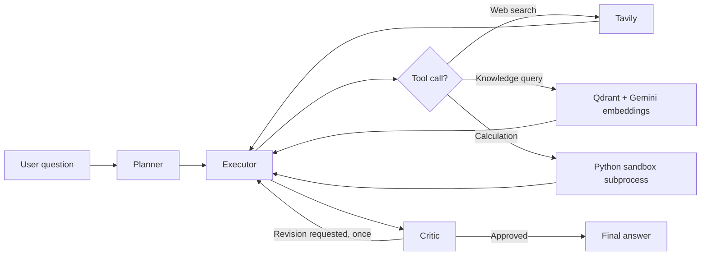

# ResearchPilot Agent

[](https://github.com/Iitian-shivansh/ResearchPilot-Agent/actions/workflows/ci.yml)

**A tool-using research agent built to be tested: a fail-closed reviewer, a sandboxed code tool with exploit regression tests, and a reproducible evaluation harness.**

🌟 **Live demo:** [researchpilot-agent-ask-query.streamlit.app](https://researchpilot-agent-ask-query.streamlit.app/)

ResearchPilot answers a question by planning, calling tools (Tavily web search, a Qdrant knowledge base, and sandboxed Python), and drafting an answer that cites the evidence it collected. A critic then has to approve it. Answers that cannot be verified are never shown as verified. Built with **LangGraph**, **Groq**, **Tavily**, **Qdrant**, **Gemini embeddings**, and **Streamlit**.

## What this project demonstrates

- **Fail-closed verification.** The critic must return a strict JSON approval, and every citation must
  match evidence produced in the current run. A malformed, unavailable, or rejecting review ends the
  run with a non-completed status; the draft is not presented as an answer.
- **An adversarially tested sandbox.** LLM-generated Python runs in a separate, restricted process:
  AST validation, an import allowlist, restricted builtins, an environment-variable allowlist,
  time and output limits, and CPU/memory limits on Linux. Two security audits are logged in
  [`docs/SECURITY.md`](docs/SECURITY.md) with each finding, its fix, and a regression test that
  fails on the pre-fix code (for example, a `str.format` attribute-traversal bypass).
- **Reproducible evaluation.** A versioned 50-case benchmark ([`benchmark/`](benchmark/)) runs
  offline and deterministically. CI regenerates [`EVALUATION.md`](EVALUATION.md) and fails if it
  differs from the committed copy. An opt-in live mode runs the same cases against the real agent.
  The offline fixtures check graph and evidence contracts, not model quality, and the report says so.
- **Tested without API keys.** 190+ offline tests use injected fake LLMs, tools, embeddings, and
  Qdrant clients, including Streamlit `AppTest` smoke tests. CI runs them on Python 3.11 and 3.12,
  alongside ruff.
- **Untrusted input handling.** Attachments and tool outputs are passed to the model as clearly
  delimited, size-bounded, untrusted reference material, and are never written to the shared
  knowledge base.

## Features

- Plan-and-execute agent graph with a planner, executor, tools node, forced-synthesis step, and critic.
- Tavily web search for current or general-purpose research.
- Qdrant vector retrieval for domain-specific documents.
- Gemini embeddings for knowledge-base queries.
- Sandboxed Python execution in a separate subprocess.
- Streamlit UI with per-node progress, verified-only answers, and a safe reason when a run fails.
- CLI entry point for running the agent without Streamlit.
- One critic-driven revision cycle and per-mode tool budgets against unbounded tool loops.
- Explicit run, critic, and citation statuses so failed verification is not shown as approval.
- Structured tool-result envelopes with evidence identifiers for web, knowledge-base, and calculation outputs.
- Task-scoped `.txt` and `.md` attachments with bounded size/count validation; attachments are temporary prompt context and are never inserted into shared Qdrant.
- Follow-up conversation state in Streamlit, with Quick, Deep, Compare, and Analyze research modes.
- Per-node execution progress and downloadable Markdown reports.
- A low-latency fast path for short conversational questions that do not require research,
  using one model call and skipping planning, tools, and critic review.
- Strict JSON critic decisions (`approved`, `revise`, or `rejected`); malformed or unavailable
  critic responses fail closed and are never presented as verified answers.
- Tavily, Qdrant, and Python all emit the same `ToolResult` envelope with citeable evidence.

## Architecture



The executor is configured with `qwen/qwen3.8-27b` through `langchain-groq`. Tool execution is capped per research mode (Quick: 2, Analyze: 3, Deep and Compare: 4 distinct tool executions), and consecutive tool errors are capped at two. When a cap is reached, a dedicated synthesis step writes the answer from the evidence gathered so far. The critic can send the draft back to the executor for one revision.

Critic approval requires a valid JSON decision and citations that match evidence produced in
the current run. Evidence from earlier follow-up turns is not eligible, and fabricated or
ambiguous citation text is rejected. If the critic is unavailable, malformed, or rejects the
draft, the terminal status is non-completed (`critic_failed` or `critic_rejected`).

## Repository layout

| Path | Purpose |
|---|---|
| `app.py` | Streamlit application with follow-up chat, task attachments, modes, progress, and Markdown export |
| `src/agent.py` | LangGraph workflow and retry/safeguard logic |
| `src/contracts.py` | Structured tool results and evidence models |
| `src/tools.py` | Tavily, Qdrant, and Python tools |
| `src/sandbox.py` | Sandbox validation, limits, subprocess orchestration, and result parsing |
| `src/_sandbox_worker.py` | Restricted worker process that executes generated Python |
| `src/main.py` | CLI runner with a textual execution trace |
| `src/attachments.py` | Bounded validation and formatting of temporary task attachments |
| `src/modes.py` | Research mode instructions and tool-budget defaults |
| `src/report.py` | Markdown report export |
| `src/ingestion.py` / `ingest.py` | Knowledge-base ingestion library and CLI |
| `src/evaluation.py` / `evaluate.py` | Evaluation metrics and the benchmark runner (offline by default) |
| `benchmark/` | Versioned 50-case benchmark and regression thresholds |
| `tests/` | Offline unit and regression tests (no API keys or network needed) |
| `scripts/check_connections.py` | Optional live Qdrant and Gemini connectivity check |
| `scripts/check_models.py` | Optional live Groq model-list diagnostic |
| `.github/workflows/ci.yml` | CI: tests, offline benchmark, report reproducibility, lint |
| `docs/SECURITY.md` | Threat model, controls, limitations, and security audit history |
| `demo_traces/` | Example plan/execute/self-correction trace |

## Requirements

- Python 3.10 or newer
- API keys for Groq, Tavily, and Google Gemini
- A Qdrant Cloud collection for knowledge-base retrieval (`documents` by default; set `KB_COLLECTION` to change it for both the agent and `ingest.py`)
- Windows, macOS, and Linux are supported; the strongest OS-level resource limits are available on Linux

## Installation

Create and activate a virtual environment, then install the dependencies:

```powershell
python -m venv venv
.\venv\Scripts\activate
python -m pip install -r requirements.txt
```

On macOS/Linux:

```bash
python3 -m venv venv
source venv/bin/activate
python -m pip install -r requirements.txt
```

Copy `.env.example` to `.env` and fill in the values:

```env
GROQ_API_KEY=your_groq_api_key
TAVILY_API_KEY=your_tavily_api_key
GEMINI_API_KEY=your_gemini_api_key
QDRANT_URL=https://your-cluster-url
QDRANT_API_KEY=your_qdrant_api_key
```

Never commit `.env` or real credentials. The application loads these variables with `python-dotenv`.

## Qdrant knowledge base

The retrieval tool expects:

- collection name: `documents`
- vector embeddings compatible with `models/gemini-embedding-001`
- payload field `text` containing the indexed chunk
- optional payload fields `document_id` and `chunk_index` for result labels
- `source_hash` and `ingestion_run_id` for lifecycle tracking

The repository includes a local document-ingestion command for `.txt`, `.md`, and text-based
`.pdf` files. It recursively scans a directory, extracts, normalizes, and chunks text, creates
or validates the collection, generates Gemini embeddings, and upserts deterministic Qdrant point
IDs. Documents are limited to 10 MB each. Before replacing a source, it deletes that source's
previous chunks, preventing stale content from surviving after a file is edited. Re-running the
command for unchanged files is safe.

```bash
python ingest.py ./knowledge_base
```

The command expects `QDRANT_URL`, `QDRANT_API_KEY`, and `GEMINI_API_KEY` in `.env`. Optional settings are available for collection name and chunking:

```bash
python ingest.py ./knowledge_base --collection documents --chunk-size 1200 --chunk-overlap 200 --batch-size 64
```

Each point contains the payload fields used by retrieval:

- `text`: normalized document chunk
- `document_id`: path relative to the ingested directory
- `chunk_index`: zero-based chunk number

PDF support uses `pypdf` and extracts text only; scanned/image-only PDFs may produce no usable
text and are rejected if the complete ingestion contains no non-whitespace chunks.

Retrieval can be tuned without code changes:

```env
KB_TOP_K=5
KB_SCORE_THRESHOLD=0.0
```

`KB_TOP_K` limits the number of Qdrant results and `KB_SCORE_THRESHOLD` filters low-scoring
matches. The retrieval tool returns structured evidence IDs such as `[KB-1]` with document,
chunk, score, and excerpt metadata.

## Run the application

Start the Streamlit UI:

```bash
streamlit run app.py
```

On Windows, `start.bat` creates no environment by itself; it expects an existing `venv` directory, installs `requirements.txt`, and starts Streamlit:

```bat
start.bat
```

The UI shows per-node progress (planner, executor, tools, synthesis, critic) and the final answer only when it is verified. When a run does not produce a verified answer, the UI shows the terminal status and a safe reason (for example, an authentication or rate-limit problem, or a critic rejection). A query can take a minute on free-tier LLM limits.

The Streamlit UI supports follow-up questions in the same browser session. Choose a research
mode (Quick, Deep, Compare, or Analyze) in the sidebar. Attach up to five UTF-8 `.txt` or
`.md` files (1 MB each, 4 MB total); their contents are supplied only as temporary context for
that task and are not persisted or indexed in Qdrant. The last result can be exported as a
Markdown report containing the question, mode, answer, attachment names, and execution trace.
PDF attachments are intentionally not supported in this phase.

Short questions without research terms or attachments use a direct one-call response path.
Questions involving research, comparisons, current information, sources, or attachments
continue through the full planner-executor-tools-critic workflow.

## Run from the CLI

With the virtual environment active:

```bash
python -m src.main "What is the capital of France?"
python -m src.main --mode Quick "Compare two vector databases"
```

If no question is provided, the CLI prompts interactively. The CLI prints the trace, the final status, and exits with `0` only for a verified answer. The CLI requires `GROQ_API_KEY`, `TAVILY_API_KEY`, and `GEMINI_API_KEY` to be present, even when a particular question does not use every integration.

## Tests and evaluation

### Milestone 2 benchmark

`benchmark/milestone2_v1.json` is a versioned 50-case contract benchmark. The
reproducible evaluator is offline by default: it uses deterministic fixtures,
makes no model, vector database, or web calls, and writes both
`evaluation-results.json` and `EVALUATION.md`.

```bash
python evaluate.py
```

The report includes per-case expected behavior and the explicitly named
`offline_fixture_task_success_rate`, evidence validity and coverage,
claim-support labels, unsupported-claim counts, recovery, and latency/usage/cost
availability, plus aggregate regression thresholds from
`benchmark/thresholds.json`. Live evaluation is never implicit; `python
evaluate.py --live` requires all production configuration and runs selected cases
against the configured agent, using each case's research mode. Use `--limit N` and
repeatable `--category NAME` to control consumption.

Only a full offline run rewrites the tracked `EVALUATION.md` and
`evaluation-results.json`; a `--category` subset or `--no-write` run only prints results.
CI regenerates both files and fails if they differ from the committed versions, so the
published numbers are always reproducible.

### Unit and regression tests

All tests are offline: they use injected fake LLMs, tools, embeddings, and Qdrant clients, and
need no API keys or network access.

```bash
python -m unittest discover -s tests -t . -v
# or, if pytest is installed (configured in pyproject.toml to collect tests/ only):
python -m pytest
```

Run a single area with, for example, `python -m unittest tests.test_sandbox -v`.

### Live evaluation (optional)

Run the live evaluation only after configuring all services:

```bash
python evaluate.py --live --limit 3
python evaluate.py --live --limit 10 --thresholds benchmark/thresholds.json
```

The live evaluation makes multiple real LLM/tool calls and writes
`evaluation-results-live.json` (gitignored). It exits non-zero if any case errors, and, when
`--thresholds` is given, if any threshold is missed; without `--thresholds` it reports metrics
but does not claim a regression gate.

The offline evaluator validates graph status and structured evidence integrity and exits
non-zero for contract violations. Its synthetic cases are intentionally not a measure of model
quality; use the live evaluation and human review for that.

### Diagnostics (live network)

```bash
python scripts/check_connections.py   # Qdrant + Gemini
python scripts/check_models.py        # Groq models available to your key
```

## Sandbox security

Generated Python is not executed inside the Streamlit process. Before launching the worker, the parent process applies:

- AST validation for dangerous names, dunder attributes, non-approved imports, and
  runtime-built format strings (`str.format` field lookups can otherwise reach dunder attributes).
- A defense-in-depth string blocklist applied to code only; string literals and comments are
  treated as data, so retrieved text that mentions words like "requests" is not rejected.
- Code-size, output-size, and wall-clock limits.
- A minimal environment-variable allowlist.

The worker additionally restricts builtins and imports, captures output, and returns a structured result. On Linux it applies CPU, virtual-memory, file-size, and core-dump limits. On Windows, Python's standard library does not provide equivalent resource limits, so the wall-clock timeout is the primary resource control.

This is a subprocess-based defense-in-depth sandbox, not a hardened container or VM. It does not provide seccomp, filesystem mount isolation, network namespaces, or multi-tenant isolation. See [`docs/SECURITY.md`](docs/SECURITY.md) before using it with untrusted workloads.

## Phase one reliability work

The agent graph now separates execution outcomes such as `completed`, `completed_after_revision`,
`fast_completed`, `critic_failed`, `critic_rejected`, `planner_failed`, `executor_failed`,
`synthesis_failed`, and `fast_path_failed`. If the tool
budget is exhausted, the graph runs a dedicated synthesis step instead of terminating on a tool
call. Tool outputs use a stable JSON envelope and may include evidence IDs such as `[KB-1]` or
`[CALC-1]`, which the critic checks before approval.

This design is intentionally resume-friendly: the graph can be tested without API keys by
injecting fake LLM/tool implementations, while production construction still uses Groq, Tavily,
Gemini, and Qdrant.

## Known limitations

- Groq free-tier rate limits can make requests slow or fail temporarily.
- Tool-call formatting errors from the LLM are retried once with simplified instructions.
- Knowledge-base retrieval depends on Qdrant and Gemini credentials.
- PDF ingestion extracts text but does not perform OCR; image-only PDFs are unsupported.
- Streamlit coverage uses `streamlit.testing` AppTest smoke tests with a fake agent graph (`tests/test_app.py`); real-browser end-to-end tests are not yet included.
- Windows does not receive the Linux-only CPU and memory limits.
- Citation checking in `evaluate.py` is heuristic rather than a formal correctness metric.

## Project status and next gaps

The core agent, UI, integrations, sandbox, documentation, ingestion pipeline, structured evidence contracts, and mocked agent test suite are implemented. The most useful next improvements are:

1. Improve citation extraction and evaluation beyond heuristics.
2. Run the offline benchmark through the real graph with recorded model responses.
3. Consider container-based execution for stronger isolation in production.

## License

See [`LICENSE`](LICENSE).
